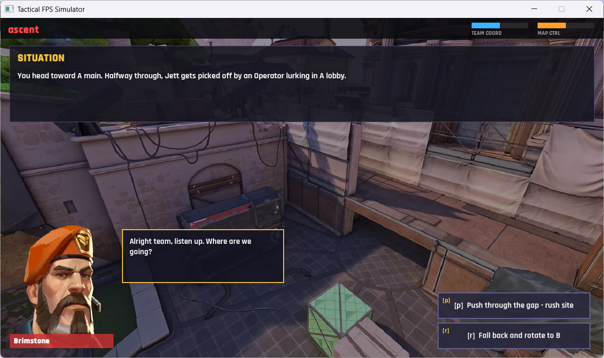
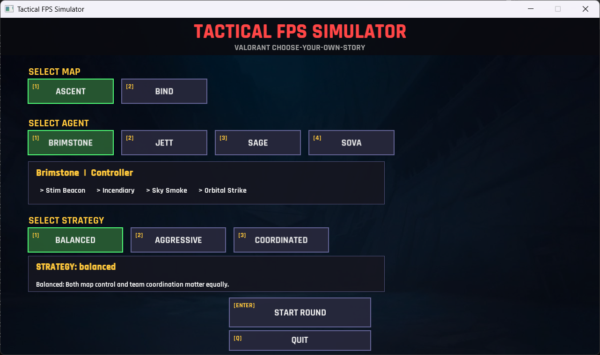
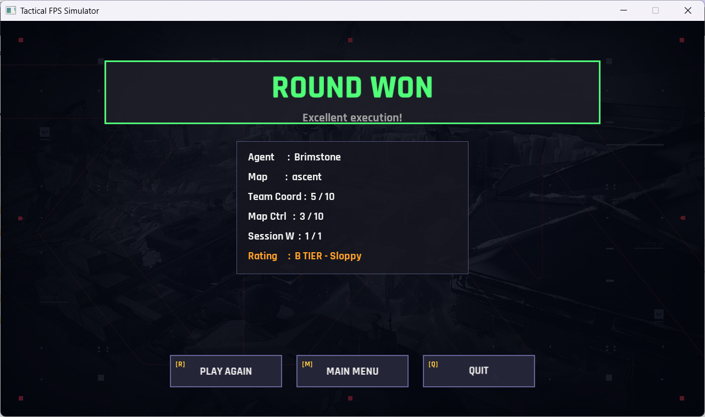

# Tactical FPS Simulator

Parte din proiectul meu. Joc tactic bazat pe scenarii, inspirat de shooterele tactice (stil Valorant),
scris în C++17 cu SFML 3. Alegi harta, agentul și strategia, apoi iei decizii
la fiecare pas al rundei, iar rezultatul depinde de alegerile tale și de noroc.

## Funcționalități

- Meniu principal cu selecție de hartă, agent și strategie
- 4 agenți jucabili, câte unul din fiecare rol
- Hărți încărcate dinamic din `data/maps/*.map`
- Hartă de rezervă (Ascent) generată automat dacă nu există fișiere de hartă
- Scenarii ramificate, cu mai multe finaluri (câștig / pierdere)
- 3 strategii de calcul al rezultatului
- Control cu mouse-ul (click) sau cu tastatura
- Ecran de statistici pe sesiune (runde jucate / câștigate)
- Logare și gestionare a excepțiilor

## Cum se joacă

1. Din meniu alegi **harta**, **agentul** și **strategia**.
2. Fiecare pas al rundei afișează o situație și 2-3 opțiuni.
3. Alegi o opțiune cu **click** pe ea sau de la **tastatură**.
4. Runda se termină într-un nod final: **câștig** sau **pierdere**.
5. La final vezi statisticile sesiunii și poți relua runda cu aceeași
   configurație sau te poți întoarce în meniu.

## Agenți

| Agent     | Rol        |
|-----------|------------|
| Brimstone | Controller |
| Jett      | Duelist    |
| Sage      | Sentinel   |
| Sova      | Initiator  |

Fiecare agent are un portret (`.png`), o listă de abilități și replici
(callouts) specifice situației din rundă.

## Strategii

Rezultatul unui moment decisiv se calculează din două valori
(`teamCoordination` și `mapControl`) la care se adaugă un număr aleatoriu.

| Strategie     | Câștig dacă                                | Caracteristici                          |
|---------------|--------------------------------------------|-----------------------------------------|
| `aggressive`  | `mapControl*2 + coord + rand(0..15) > 12`  | Favorizează controlul hărții, risc mare |
| `coordinated` | `coord*2 + mapControl + rand(0..10) > 10`  | Favorizează coordonarea echipei         |
| `balanced`    | `coord + mapControl + rand(0..10) > 8`     | Echilibrată (implicită)                 |

## Arhitectură

- **Application**: fereastra, bucla principală și tranziția între ecrane
- **Screens**: `MainMenuScreen`, `GameScreen`, `StatsScreen`
- **Agent** (clasă abstractă) cu derivate `Brimstone`, `Jett`, `Sage`, `Sova`,
  create prin `AgentFactory` (Factory)
- **GameMap**: graful unei hărți (nod de start, fundal implicit, noduri
  `ScenarioNode` căutate după id)
- **IOutcomeStrategy**: strategii interschimbabile (Strategy pattern)
- **EventBus**: comunicare între componente
- **ConfigManager**, **Logger**: configurare și logare
- **GameException**: ierarhie proprie de excepții
